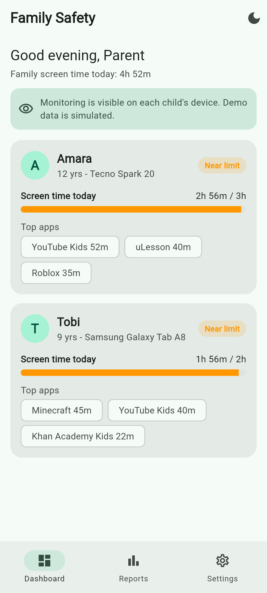
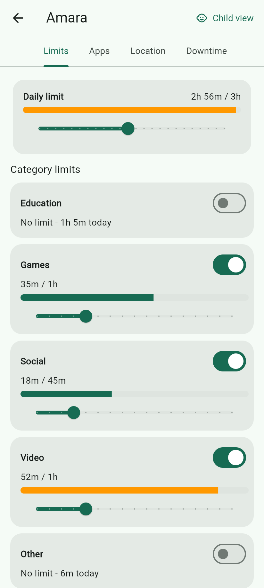
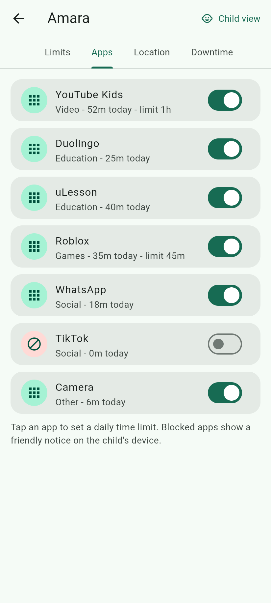
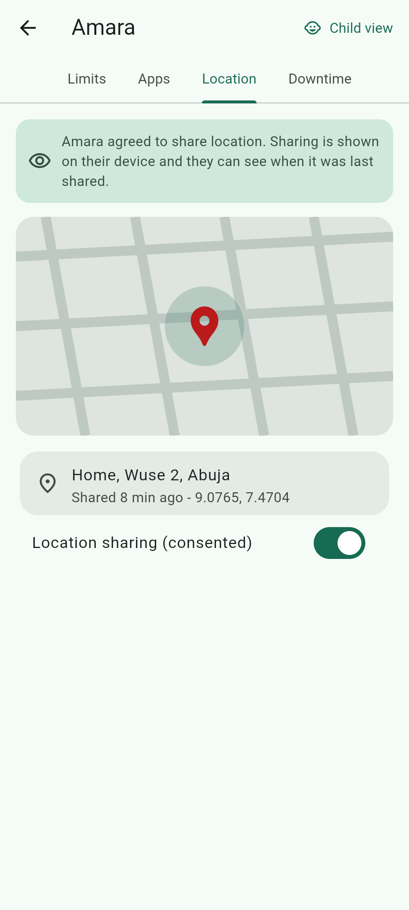
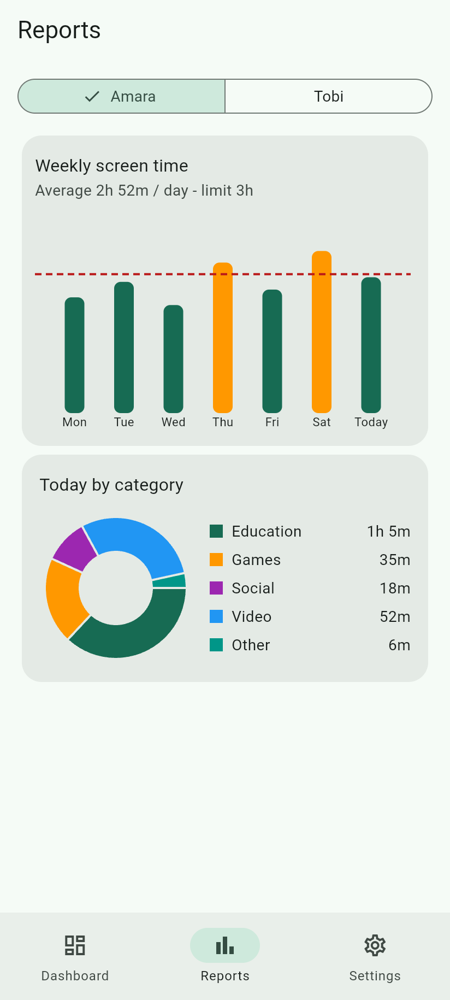
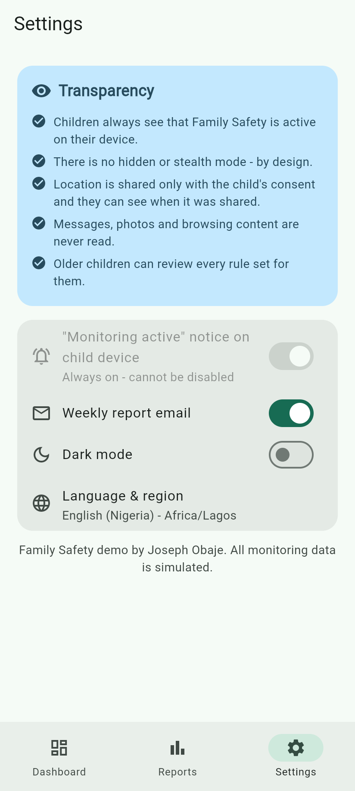
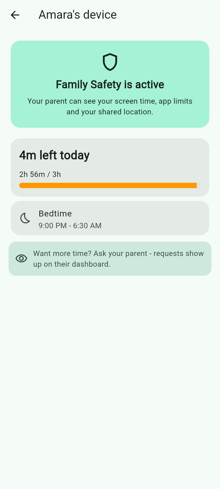
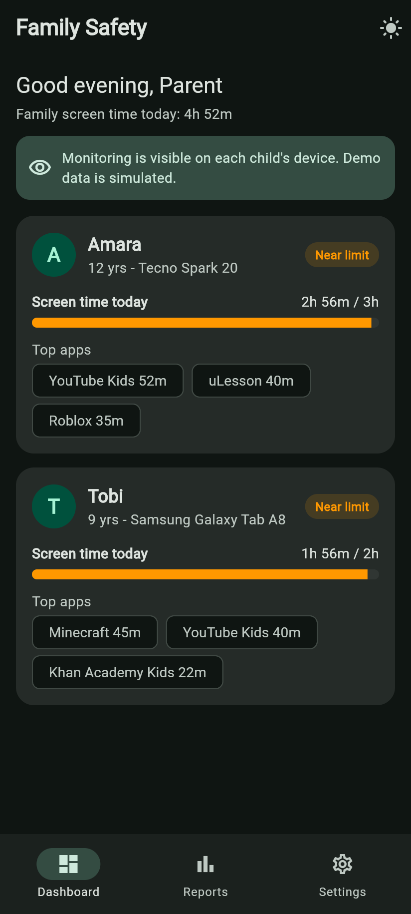

# Family Safety: Flutter Parental-Controls App

A clean, transparent **parental-controls / family-safety app** built with Flutter. Parents get a dashboard of each linked child's screen time, daily and per-category limits, app allow/block controls, consent-based location sharing, bedtime downtime and weekly reports. Children always get a matching "Family Safety is active" view on their own device.

> **Important:** all monitoring data in this project is **simulated** (local mock data). The app is designed for **transparent, consent-based family use**. It has **no hidden or stealth mode**, it never reads messages, photos or browsing content, and it is **not a covert spying tool**.

   

## Features

- **Parent dashboard**: every linked child with today's screen time, usage vs limit, top apps and a status chip (On track / Near limit / Limit reached).
- **Screen-time limits**: daily limit per child plus optional limits per app category (Education, Games, Social, Video, Other) with live usage bars.
- **App management**: allow/block toggle for each app and per-app daily time limits.
- **Location sharing with consent**: last shared location on a map placeholder, with a clear notice that sharing was agreed to and is visible to the child.
- **Reports**: weekly screen-time bar chart with the limit line, and a by-category pie chart (fl_chart).
- **Bedtime / downtime schedule**: start and end times with overnight-range support.
- **Child view**: what the child sees, including time left today, bedtime and the "monitoring is active" notice.
- **Transparency settings**: an always-on child notice that cannot be disabled, plus a plain-language explanation of what is and isn't monitored.
- Light and dark theme, responsive layout (bottom bar on phones, navigation rail on tablets and web), English (Nigeria) and Africa/Lagos defaults.

## Screenshots

| Dashboard | Screen-time limits | App management | Location (consent) |
|---|---|---|---|
|  |  |  |  |

| Reports | Transparency | Child view | Dark mode |
|---|---|---|---|
|  |  |  |  |

## Tech stack

- Flutter 3 / Dart 3, Material 3
- [provider](https://pub.dev/packages/provider) (`ChangeNotifier`) for state
- [fl_chart](https://pub.dev/packages/fl_chart) for charts
- `flutter_test` for unit and widget tests

## Getting started

```bash
git clone https://github.com/Josephobaje/flutter-family-safety-app.git
cd flutter-family-safety-app
flutter pub get
flutter run            # Android / iOS device or emulator
flutter run -d chrome  # web
```

## Tests

```bash
flutter analyze   # no issues
flutter test      # 8 unit + widget tests
```

Tests cover time formatting, overnight downtime logic, usage totals and status, state updates (limits, app blocking, consent), and widget flows through the dashboard, child detail, child view, reports and settings.

## Project structure

```
lib/
├── main.dart
├── app.dart                      # Provider + MaterialApp, light/dark theme
├── data/mock_data.dart           # simulated family data
├── models/models.dart            # ChildProfile, ChildApp, DowntimeSchedule, LocationPing
├── state/family_state.dart       # ChangeNotifier with all actions
├── screens/
│   ├── home_shell.dart           # responsive navigation
│   ├── dashboard_screen.dart
│   ├── child_detail_screen.dart  # Limits, Apps, Location, Downtime tabs
│   ├── child_view_screen.dart    # what the child sees
│   ├── reports_screen.dart
│   └── settings_screen.dart      # Transparency section
├── theme/app_theme.dart
├── utils/format.dart
└── widgets/common.dart           # UsageBar, TransparencyBanner, StatusChip
test/
├── models_test.dart
└── widget_test.dart
```

## Taking it to production

A real deployment would add a companion child app that uses Android's official Digital Wellbeing / UsageStats APIs (and Apple's Screen Time API on iOS) with clear on-device disclosure, plus a backend for syncing. The repository layer here is mock-only on purpose.

## Author

**Joseph Obaje**, Full Stack Developer (PHP, Python, Flutter) and Cybersecurity Specialist

- GitHub: [@Josephobaje](https://github.com/Josephobaje)
- LinkedIn: [joseph-obaje](https://www.linkedin.com/in/joseph-obaje)
- Email: [josephobaje264@gmail.com](mailto:josephobaje264@gmail.com)

## License

Released under the [MIT License](LICENSE). © 2026 Joseph Obaje
